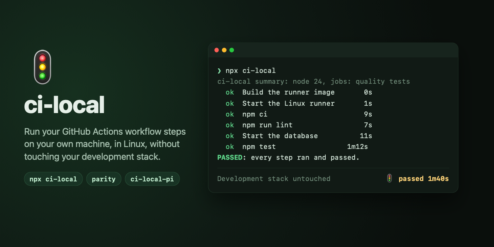

# 🚦 @jals1212/ci-local-pi



The [Pi](https://pi.dev) package for [`@jals1212/ci-local`](https://github.com/jals1212/ci-local):
ci-local's state in Pi's status line, cards in the transcript, a read-only
tool for the agent, and a skill that says how to run and wait for ci-local.
Install it once, for every repository:

```sh
pi install npm:@jals1212/ci-local-pi
```

It needs Pi 0.84.3 or later (the `agent_settled` and
`session_compact_failed` events, entry renderers, and `PI_SESSION_ID` in the
bash tool).

Until 0.7.x, the extension shipped inside `@jals1212/ci-local`. If you
installed it from there, switch: `pi install npm:@jals1212/ci-local-pi`, then
`pi remove npm:@jals1212/ci-local`.

## What it follows

In a session opened inside a repository with `ci-local.config.sh` (with a
literal `CI_PROJECT=`), it follows the events file of that project; it never
runs ci-local or Docker itself:

- **Status line**: `🚦 ci-local · ◌ queued · 2 ahead (erp-ci running)`, `🚦 ci-local · ⧗ [3/8] lint · 2m05s`,
  then `🚦 ci-local · ✓ passed · 4m12s · 10m ago` or `🚦 ci-local · ✗ failed at lint · 2m10s · just now`
  until the next run. A result says how long ago it ended for its first hour,
  then the local time it ended (`· 13:10`). A run already over when a session starts shows only while its
  result is undelivered, like an unread message: it ended with no session of
  the repository open. Once a session has shown it finished, a later session
  (new or resumed) leaves it out, and a reload keeps it out unless that
  session is the one that showed it. Each session records the last run it
  showed in its own file, under `<events file>.delivered.d/` (a file unused
  for 30 days is removed). A run in flight, and every later one, shows. Pi shows it in the footer. A shell that draws its own chrome
  shows it where it lists extension statuses: Gentle Shell, for one, under
  **Integrations** in the sidebar's Status card (or in its bottom bar on a
  narrow terminal).
- **Herdr sidebar**: in a [Herdr](https://herdr.dev) pane (`HERDR_ENV=1`,
  `HERDR_PANE_ID`, `HERDR_SOCKET_PATH`), the status line is also the pane's
  `ci` metadata token while a run is queued or running, and its result for 5
  minutes after it ends. The token is display only: the agent's state in
  Herdr does not change. It is reported again every 10 seconds with a
  30-second TTL, so it goes away when Pi does. To show it, add a `$ci` row to
  the Agents sidebar in Herdr's `config.toml`, then run `herdr server reload-config`:

  ```toml
  [ui.sidebar.agents]
  rows = [
    ["state_icon", "machine", "workspace", "tab"],
    ["agent"],
    [{ token = "$ci", rules = [
      { contains = "✗", fg = "#f38ba8" },
      { contains = "✓", fg = "#a6e3a1" },
      { contains = "⧗", fg = "#f9e2af" },
    ] }],
  ]
  ```
- **herdr-app sidebar**: in a terminal of the [Herdr app](https://herdr.dev)
  (herdr-core sets `HC_TERMINAL_ID`), the same line is the terminal's `ci`
  label, set with `hc label <terminal> ci=<line>`, with the same 5-minute
  result window. A label has no TTL: the session removes it when it ends, and
  a session that starts in another terminal first removes it from the one it
  leaves, so a Pi killed without ending can leave the last line until the
  next session replaces it. Both sidebars are served when both environments
  are present. The Herdr app's shipped Agents panel does not show labels, so
  showing it takes a copy of that panel (mods and layouts shipped with Herdr
  are read-only; a clone is yours):

  1. Clone the layout you use and the `agents` mod:

     ```sh
     herdr-app do layout.clone '{"name":"main","as":"my-layout"}'
     herdr-app do mod.clone '{"name":"agents","as":"my-agents"}'
     ```

  2. In `~/.config/herdr-app/layouts/my-layout.json`, point the Agents block
     to the clone: `"content": { "mod": "my-agents" }`.
  3. In `~/.config/herdr-app/mods/my-agents/main.js`, import `terminals` from
     `"herdr"`, read each terminal's labels by address, and add a line to the
     agent's row when it has a `ci` label:

     ```js
     // where the rows are built: the labels of every terminal, by address
     const labelsOf = new Map(terminals().map((x) => [x.address, x.labels ?? {}]))

     // in the row of agent `a` (`t` is the mod's theme())
     const ci = labelsOf.get(a.address)?.ci ?? ''
     const ciColor = ci.includes('✗') ? '#f38ba8' : ci.includes('✓') ? '#a6e3a1' : ci.includes('⧗') ? '#f9e2af' : t.muted
     // ...the row...
       .when(Boolean(ci), (el) => el.child(div().min_w(0).truncate().text_size(12).text_color(ciColor).child(ci)))
     ```

  4. Check the mod, which the app reloads on save:
     `herdr-app check ~/.config/herdr-app/mods/my-agents`.

  To try the mod without a run, set a label by hand in a Herdr app terminal
  with `hc label "$HC_TERMINAL_ID" ci="✓ test"`,
  and remove it with `hc label "$HC_TERMINAL_ID" ci=`.
- **Only the session's own runs** get the cards and the notification, and
  reach the agent: runs this session started. A run started from Pi's bash
  tool names its session (ci-local records Pi's `PI_SESSION_ID` as `session`
  in its events), wherever its process goes; one that names none, as a
  Gentle AI background job, is the session's when the pids above it, which
  it records at start (`ancestors`), include the session's process, so a run
  orphaned since (`nohup`, `setsid`) is still found; a run that recorded none
  (before 0.6.0) is the session's when its live process descends from the
  session's. The recorded pids are not checked against start times: if Pi's
  pid is given to another process later, an old run of the same events file
  could be taken for the session's, and its card shown once too often. A run started by another session in the same repository,
  or in a terminal, shows in the status line alone, as Gentle AI's
  background-job notices go only to the session that started the job.
- **When a run starts**: a card in the transcript when it is starting, or
  waiting for its turn (`🚦 ◌ ci-local · queued · behind erp-ci`), and another
  when its steps start (`🚦 ⧗ ci-local · running · [1/14] …`). They are for you
  only: session entries, never in the model's context, and not shown again
  after a reload.
- **When a run the session saw in flight ends**: a notification at once, and
  a card in the transcript with the `--status` block. The card says it comes
  from the extension, and reaches the agent the way Gentle AI hands a
  subagent's result to its parent:
  - **idle**: the card is stored in the conversation at once, without a
    turn; then one hidden message wakes the agent, 2 seconds after the run's
    process has exited (10 seconds after the card at most). When the run was
    started as a background job, that job's own exit notice usually wakes
    the agent first, and the card is already there: one reply covers both,
    and ci-local sends no wake;
  - **in a run** (busy): the card is steered in before its next model call,
    not once the whole task is over;
  - **busy without a run** (compacting): the card waits until the agent can
    take it.

  A delivery that fails is tried again (every 30 seconds, 3 times, then at
  the next turn boundary), never dropped. A run already over when the
  session starts is not announced.
- **Tool `ci_local_status`**: the same three lines for the agent, without a
  shell.
- **Tool `ci_local_run`**: starts the repository's own ci-local
  (`node_modules/.bin/ci-local`, else the one on `PATH`) with optional
  arguments (`args`), detached from Pi: its own process group, no terminal,
  stdout and stderr in a private file it names (under `$TMPDIR`, removed by a
  launch a week later). The run records the
  session's `PI_SESSION_ID`, so it is the session's own. The tool returns
  once the run is queued or started (up to 15 seconds: a run of the same
  project that still holds the events file keeps a new one silent until its
  turn), or with its output when it ends first (`--list`, `--print-plan`, a
  usage or config error, a busy machine with `--no-wait`). There is no
  background job, so no job notice: the footer and the end card report the
  run, and the hidden wake reaches an idle agent. A launch that ends after
  the tool returned without the session ever seeing its run (no event, or
  one replaced before the session read it) gets a failed end card with the
  end of its output.
- **Skill `ci-local`**: how an agent runs and waits for ci-local (with
  `ci_local_run`, else in the background, quiet without a terminal; never two
  runs; read only the failing step's log).
  Branch and merge policy stay the project's.

The extension follows the file ci-local would write: `CI_LOCAL_EVENTS` from
Pi's environment (a relative path is taken from the repository root, where
runs are started as a rule), else the cache. When runs write no events
(`CI_LOCAL_EVENTS=off`, or a `TMPDIR` fallback cache that is not a private
directory of yours), the extension follows nothing.

## Which ci-local it reads

The events file is the contract between ci-local and this package, and the
[ci-local README](https://github.com/jals1212/ci-local#events-contract)
documents its fields. This package reads events of `schema` 1, written by
ci-local 0.6.0 and later. Older events (0.4.x and 0.5.x, from before the
`schema` field) still render: a field they lack is simply not shown. It
installs `@jals1212/ci-local` ^0.7.0 for the one renderer that `--status` and
the cards share, so a repository's own ci-local may be older or newer, as long
as its events are of schema 1.

Fields are only added within a schema; removing one or changing its meaning
raises `schema`, and this package then needs a new major version.

Nothing here changes how `npx ci-local` runs: it is a separate install.
